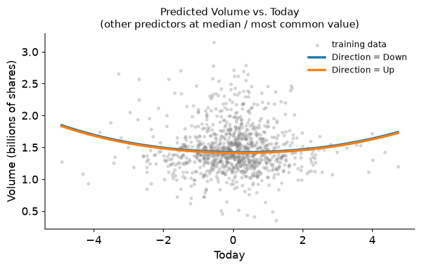
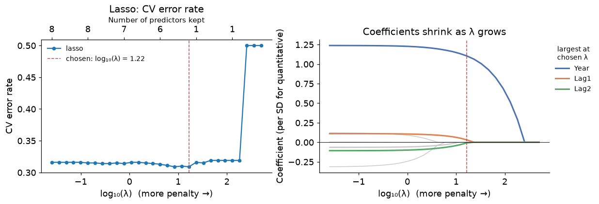

# Stock Market Volume Regression
### What Drives Daily Trading Volume on the S&P 500?
**COGS 109 — Modeling and Data Analysis | UC San Diego | Fall 2026**

---

## Overview

This project models **daily trading volume** on the S&P 500 using 1,250 trading days
from 2001 to 2005 (the ISLP *Smarket* dataset). It has two parts:

1. **Checkpoint 1: linear regression.** Predict how many shares are traded on a given day.
2. **Checkpoint 2: logistic regression.** Turn volume into a yes/no outcome (a
   *high-volume day* or not), and let model selection and regularization choose the predictors.

---

## Research Questions

> **Checkpoint 1:** *Is market turbulence (large price moves, up or down) associated
> with higher trading volume?*

> **Checkpoint 2:** *Which factors predict whether a day is a high-volume trading day
> (volume above the training-set median of 1.42 billion shares)?*

---

## Key Findings

- **Turbulence goes with higher volume.** In the linear model, a squared term on the day's
  return (`Today²`) was significant (p < 0.001): volume rises when the market moves a lot
  **in either direction**, giving a U-shaped curve.
- **Direction doesn't matter by itself.** Up days and down days had about the same volume
  (−0.8% difference, not significant). Moving a lot matters, not which way the market moves.
- **Volume grew over time.** Holding everything else fixed, volume rose about **10.4% per year**.
  In the logistic model, each additional year multiplied the odds of a high-volume day by
  **2.37** (bootstrap 95% CI: 2.16 to 2.70).
- **Predictive performance.** The linear model explains about **32%** of the variance in volume
  on held-out test data (test R² = 0.318). The lasso logistic model classifies **64%** of test
  days correctly (AUC = 0.71), compared with 49% for always guessing the most common class.



---

## Checkpoint 1 — Linear Regression

**Model:** log(Volume) = β₀ + β₁·Direction[Up] + β₂·Year + β₃·Today + β₄·Today² + ε

| Term | Estimate | 95% CI | p-value | Interpretation |
|---|---|---|---|---|
| Year | 0.099 | [0.089, 0.109] | < 0.001 | +10.4% volume per year |
| Today | −0.004 | [−0.022, 0.013] | 0.63 | linear part of the U-shape |
| Today² | 0.010 | [0.004, 0.016] | < 0.001 | bigger moves → more volume |
| Direction[Up] | −0.008 | [−0.047, 0.031] | 0.67 | no real difference vs. Down |

**Assumption checks:** Linearity and constant variance held. Normal errors and independent
errors were **violated**. The log transform overcorrected the skew, so a square-root
transform was tried as a fix. The rows are consecutive trading days, so residuals are
autocorrelated (lag-1 correlation ≈ 0.5). No multicollinearity problems (all VIFs < 2.3).

**Test performance (square-root model):** test MSE = 0.078, test R² = 0.318
(train R² = 0.317, so there's no sign of overfitting).

---

## Checkpoint 2 — Logistic Regression, Model Selection, and Regularization

**Outcome:** `HighVolume` = 1 if Volume > 1.42 billion shares (the training median),
giving a 50/50 class split.

Each group member used a different selection method on the same pool of 8 candidate
predictors, the same train/test split, and the same 5 cross-validation folds:

| Member | Method | Predictors kept | CV error | Test accuracy | AUC |
|---|---|---|---|---|---|
| Monica | Forward stepwise | Year, Lag1 | 0.303 | 0.636 | 0.713 |
| **Katherine** | **Lasso** | **Year, Lag1, Lag2** | **0.299** | **0.640** | **0.712** |
| Shourya | Ridge | all 8 | 0.308 | 0.628 | 0.720 |
| Baseline | Always predict "not high-volume" | — | — | 0.488 | 0.500 |

**Selected model (lasso):**
log(p / (1 − p)) = −1730 + 0.864·Year + 0.102·Lag1 − 0.087·Lag2, where p = P(high-volume day)

All three methods agreed that **Year** is the most important predictor, and Lag1 was kept by
every method. The models performed almost the same, so a small model with 2 to 3
predictors predicts as well as using all 8.



---

## Limitations

- **Time-series data, random split.** Days were split into train and test at random. Volume
  trends upward over time and neighboring days are correlated, so the test set isn't fully
  independent of the training set. A time-based split (train on 2001–2004, test on 2005)
  would be a stricter test.
- **Year as a proxy.** The `Year` effect captures a long-run trend in market activity, not
  something that year itself causes.
- **Narrow time window.** 2001–2005 only; relationships may differ in other market regimes.

---

## Repository Structure

```
├── 01-Checkpoint1-LinearRegression.ipynb    # Checkpoint 1: multiple linear regression
├── 02-Checkpoint2-LogisticRegression.ipynb  # Checkpoint 2: logistic regression + lasso
├── data/
│   ├── README.md                            # Dataset description and variable dictionary
│   ├── 00-raw/                              # Original downloaded data (not committed)
│   ├── 01-interim/
│   └── 02-processed/
├── modules/
│   └── get_data.py                          # Downloads the raw dataset
├── results/                                 # Figures exported from the notebooks
├── requirements.txt
└── README.md
```

## How to Run

```bash
git clone https://github.com/khchui05/stock-market-volume-regression.git
cd stock-market-volume-regression
pip install -r requirements.txt
python modules/get_data.py   # optional: the notebooks also load the data from its URL
jupyter notebook
```

Open the notebooks in order (`01-` then `02-`). They were built in Google Colab and also run
in Jupyter.

---

## Dataset

| Dataset | Source | Observations |
|---|---|---|
| Smarket (S&P 500 daily returns and volume, 2001–2005) | ISLP textbook, originally Yahoo Finance | 1,250 trading days |

See [`data/README.md`](data/README.md) for the variable dictionary.

---

## Stack


- **Pandas / NumPy**: data wrangling
- **statsmodels**: OLS regression, logistic regression, VIFs, diagnostics
- **scikit-learn**: train/test split, stratified k-fold CV, lasso-penalized logistic regression, ROC/AUC
- **Matplotlib**: visualizations

---

## Authors

Completed as part of COGS 109 at UC San Diego (Fall 2026). Each member built their own
models on a shared dataset, train/test split, and set of CV folds.

| Author | Contribution |
|---|---|
| **Katherine Chui** | Checkpoint 1 linear model (Year, Today, Today², Direction); Checkpoint 2 lasso model |
| Monica | Checkpoint 2 forward stepwise model |
| Shourya | Checkpoint 2 ridge model |

---

## References

1. James, G., Witten, D., Hastie, T., Tibshirani, R., & Taylor, J. *An Introduction to Statistical Learning with Applications in Python* (ISLP), Springer, 2023. https://www.statlearning.com
2. ISLP `Smarket` dataset. https://github.com/intro-stat-learning/ISLP
